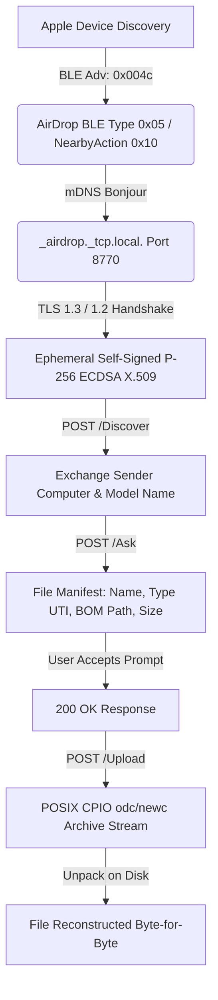

# AirDrop Cross-Platform Engine (Android <-> Apple Interoperability)

Engine and Android bridge reverse-engineered from Apple macOS `sharingd` using **REA (Reverse Engineer Anything)**.

Allows **Android phones** and **Linux/macOS workstations** to natively AirDrop files to and from any Apple device (**iPhone, iPad, Mac**).

---

## 🔬 Protocol Reverse-Engineering Summary (via REA)

By disassembling and decompiling `/usr/libexec/sharingd` (Mach-O arm64e) with REA tools, the exact proprietary AirDrop protocol stack was mapped:



### Protocol Layers
1. **Bluetooth Low Energy (BLE)**:
   - **Company ID**: `0x004C` (Apple, Inc.)
   - **Type**: `0x05` (AirDrop) or `0x10` (Nearby Action)
   - **Payload**: In *Everyone* mode, payload is zeroes. In *Contacts Only* mode, contains 8-byte SHA-256 contact hash prefixes.
2. **mDNS Bonjour Service**:
   - Service Type: `_airdrop._tcp.local.`
   - Instance Name: 12-hex character ID (e.g. `0123456789ab`)
   - TXT Records: `flags=0x01`
3. **Transport Layer Security (TLS)**:
   - Ephemeral self-signed X.509 certificates with ECDSA P-256 keys.
   - AirDrop peers do not use public CA verification; each peer validates the TLS session using contact hashing or self-signed peer acceptance.
4. **HTTP REST Endpoints**:
   - `POST /Discover`: Discovery ping returning sender metadata.
   - `POST /Ask`: Requests permission to send files. JSON dictionary contains:
     - `SenderComputerName`: Display name shown on prompt (e.g. "Pixel 8 Pro").
     - `SenderModelName`: Device icon model (e.g. `Pixel`, `MacBookPro`).
     - `SenderID`: UUID.
     - `Files`: Array of objects (`FileName`, `FileType`, `FileBomPath`, `FileIsDirectory`, `FileSize`).
   - `POST /Upload`: Streams raw **POSIX CPIO** (`odc` / `newc`) file archive ending with `TRAILER!!!`.

---

## 📁 Repository Structure

```
.
├── Cargo.toml               # Workspace manifest
├── crates/
│   ├── airdrop-core/        # Pure Rust AirDrop protocol implementation
│   │   ├── src/ble.rs       # Apple BLE Manufacturer Data builder & parser
│   │   ├── src/client.rs    # AirDrop client (/Discover, /Ask, /Upload)
│   │   ├── src/contacts.rs  # E.164 phone & email SHA-256 contact hasher
│   │   ├── src/cpio.rs      # High-performance POSIX CPIO pack/unpack
│   │   ├── src/mdns.rs      # Bonjour _airdrop._tcp peer discovery & announce
│   │   ├── src/protocol.rs  # JSON payload schemas and Apple UTI resolver
│   │   ├── src/server.rs    # Async HTTPS daemon for receiving AirDrop files
│   │   └── src/tls.rs       # Self-signed P-256 ECDSA certificate engine
│   ├── airdrop-cli/         # Verification and testing CLI utility
│   │   └── src/main.rs      # Commands: scan, send, receive, ble-payload
│   └── airdrop-jni/         # Android JNI shared library bindings (cdylib)
│       └── src/lib.rs       # C-ABI export functions for Kotlin
├── android/                 # Android Native Application (Jetpack Compose)
│   ├── app/src/main/
│   │   ├── AndroidManifest.xml
│   │   └── java/com/airdrop/android/
│   │       ├── AirDropBridge.kt     # JNI Interface & coroutines
│   │       ├── AirDropBleManager.kt # Android BLE Advertiser (0x004c)
│   │       ├── AirDropNsdManager.kt # Android Network Service Discovery
│   │       └── MainActivity.kt      # Modern Dark-Mode Jetpack Compose UI
│   ├── build.gradle.kts
│   └── settings.gradle.kts
├── docs/
│   └── airdrop_protocol_spec.md # Complete reverse-engineered protocol spec
└── scripts/
    └── build_android.sh     # Cross-compiles JNI .so libraries via cargo-ndk
```

---

## 🚀 CLI Quickstart (Testing & Verification)

### 1. Scan for Nearby Apple Devices
```bash
cargo run -p airdrop-cli -- scan --timeout 5
```
Output:
```
✨ Found 1 AirDrop peer(s):
1. Instance: 88665a39cb21
   Host: Mac-Studio.local.
   Port: 8770
   IPs: [192.168.29.18]
   Target URL: https://192.168.29.18:8770
```

### 2. Send File to Apple Device
```bash
cargo run -p airdrop-cli -- send \
  --target 192.168.29.18:8770 \
  /path/to/photo.jpg \
  --name "Android Pixel" \
  --model "Pixel 8 Pro"
```

### 3. Run Receiver on Local Machine
```bash
cargo run -p airdrop-cli -- receive \
  --port 8770 \
  --output ./received_files \
  --name "My AirDrop Target"
```

### 4. Inspect BLE Manufacturer Data
```bash
cargo run -p airdrop-cli -- ble-payload --everyone
```
Output:
```
Apple AirDrop BLE Manufacturer Data:
Company ID: 0x004C (Apple, Inc.)
Hex Payload: 051000000000000000000000000000000000
Length: 18 bytes
```

---

## 📱 Building and Deploying to Android

### 1. Compile Native Libraries (`.so`)
Make sure the Android NDK is installed, then run:
```bash
cargo install cargo-ndk
./scripts/build_android.sh
```
This generates:
- `android/app/src/main/jniLibs/arm64-v8a/libairdrop_jni.so`
- `android/app/src/main/jniLibs/armeabi-v7a/libairdrop_jni.so`
- `android/app/src/main/jniLibs/x86_64/libairdrop_jni.so`

### 2. Open Project in Android Studio
1. Open the `android` folder in Android Studio.
2. Connect your Android phone via USB with USB Debugging enabled.
3. Click **Run** (`Shift + F10`) to deploy the app to your phone.

### 3. Transferring Files from Android to iPhone / iPad / Mac
1. Open the AirDrop app on Android.
2. Tap **Select Files** and pick any photos, documents, or videos.
3. Tap **Scan** — the app will discover all nearby Apple devices on the network.
4. Tap the Apple device from the list:
   - The Apple device will immediately chime and display the native AirDrop prompt:
     `"Android Pixel" would like to share 1 file. [Decline] [Accept]`.
   - When accepted on the Apple device, the file transfers instantly over high-speed HTTPS.

### 4. Transferring Files from iPhone / iPad / Mac to Android
1. In the Android AirDrop app, toggle **AirDrop Receiver Daemon** to **ON**.
2. The phone begins broadcasting:
   - Apple BLE Manufacturer Data (`0x004c`) via `BluetoothLeAdvertiser`
   - Bonjour `_airdrop._tcp.` via `NsdManager`
3. On your iPhone, open Photos or Files, tap **Share**, and select **AirDrop**.
4. The Android phone will appear in the AirDrop target wheel!
5. Tap the Android phone to transfer. The file will be received and saved to your device's `Download/AirDrop` folder.
