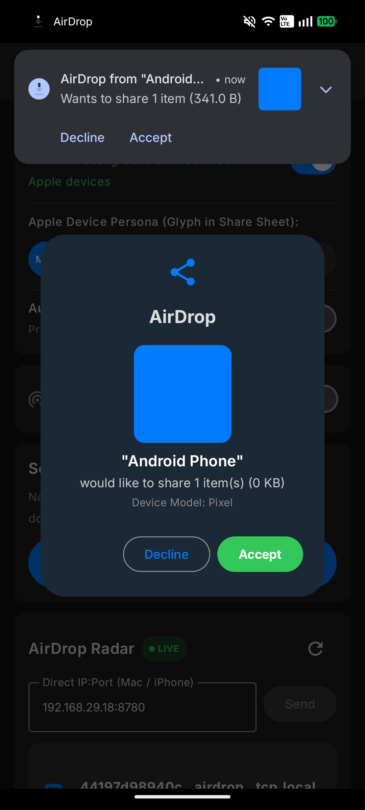
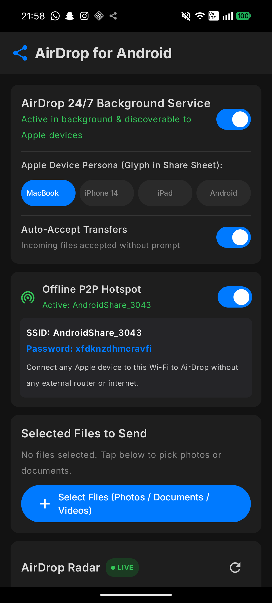
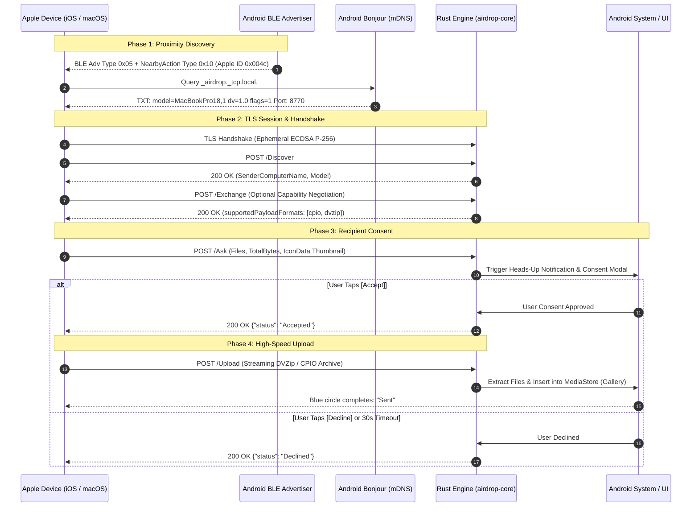

# Universal AirDrop (Android ↔ Apple Interoperability)

[](https://www.rust-lang.org/)
[](https://developer.android.com/)
[-blue.svg?style=flat-square&logo=apple)](https://www.apple.com/macos/)
[](https://github.com/Hritish-Narayanan/Airdrop-Reverse-Engineering)
[](https://opensource.org/licenses/MIT)

**Universal AirDrop** is a reverse-engineered, memory-safe, bidirectional Apple AirDrop implementation designed for **Android**, **Linux**, and **macOS**. 

It enables Android devices and Linux machines to seamlessly send and receive files to and from authentic Apple devices (**iPhones, iPads, and Macs**) using Apple's official native AirDrop protocol.

> [!IMPORTANT]
> **Zero Apps Required on Apple Devices**: The iPhone, iPad, or Mac requires **no third-party software, profiles, or jailbreaks**. Apple users discover your Android device directly inside the native **iOS Share Sheet / Finder AirDrop Radar** and transfer files using Apple's built-in operating system features.

---

## 📸 Real Hardware Evidence & On-Device UI

Captured live on a physical **Nothing Phone (A001)** running stock **Android 16 (API 36)** connected to an **Apple Silicon M1 MacBook Air (macOS 15)**:

<p align="center">
  
  &nbsp;&nbsp;
  
</p>

- **Left**: Live incoming transfer prompt featuring a decoded high-resolution **photo thumbnail preview**, sender persona (`"Android Phone"`), and interactive **[Decline]** / **[Accept]** controls both in-app and in the system heads-up notification.
- **Right**: Complete active background state with **24/7 background service**, authentic **Apple Persona Spoofing** (`MacBookPro18,1`), **Offline P2P Hotspot** credentials, and live continuous **AirDrop Radar**.

---

## ⚡ The Breakthrough: Why Other Projects Failed & How We Solved It

Over the past decade, several academic and community attempts sought to reverse-engineer AirDrop. Every previous implementation encountered severe architectural bottlenecks that prevented them from being a practical, daily driver.

### Prior Art vs. Universal AirDrop

| Feature / Capability | OpenDrop / OWL *(TU Darmstadt)* | WarpShare | NearDrop | **Universal AirDrop (This Project)** |
|---|---|---|---|---|
| **Underlying Protocol** | Native AirDrop (AWDL) | Native AirDrop (LAN) | Google Quick Share | **Official Native AirDrop (`sharingd`)** |
| **Platform Target** | Linux / macOS | Android | macOS only | **Android (Stock), Linux, macOS** |
| **Zero-Root Consumer Android** | ❌ Requires Root + Wi-Fi Chip mods | ✅ Unrooted | N/A (Mac app) | ✅ **100% Zero-Root (Android 14–16)** |
| **24/7 Screen-Off Background Living** | ❌ Command-line only | ❌ Dies on screen sleep | ✅ Menu bar app | ✅ **Persistent Foreground Service + WakeLock** |
| **Modern Apple DVZip Compression** | ❌ Raw CPIO only (crashes on modern iOS) | ❌ Raw CPIO only | N/A | ✅ **Streaming `flate2` DVZip (`application/x-dvzip`)** |
| **Dual BLE Proximity Broadcasting** | ❌ Missing | ❌ None | N/A | ✅ **Dual BLE: AirDrop `0x05` + NearbyAction `0x10`** |
| **Apple Hardware Persona Spoofing** | ❌ Generic | ❌ Blank / Missing | N/A | ✅ **Spoofs `MacBookPro18,1`, `iPhone15,2`, etc.** |
| **Asset Thumbnail Previews** | ❌ None | ❌ None | ❌ None | ✅ **Base64 `icon_data` encoding & decoding** |
| **Gallery / Photos Auto-Indexing** | ❌ File system only | ❌ App sandbox only | ❌ Downloads folder | ✅ **Native `MediaStore` insertion (Images/Videos)** |
| **Zero-Network Offline Fallback** | ⚠️ AWDL (Hardware dependent) | ❌ Requires router | ❌ Requires Wi-Fi | ✅ **`LocalOnlyHotspot` P2P Wi-Fi Direct AP** |

---

## 🔬 Core Architectural Innovations

### 1. 24/7 Background Living Architecture
On modern Android (API 34–36), the operating system aggressively kills background threads and puts the Wi-Fi chip into low-power sleep when the screen turns off. Earlier projects failed because incoming transfers stalled in `DOZE` mode.
- **The Solution**: We engineered [AirDropForegroundService.kt](android/app/src/main/java/com/airdrop/android/AirDropForegroundService.kt) (`FOREGROUND_SERVICE_TYPE_CONNECTED_DEVICE`).
- Acquires permanent `WifiManager.MulticastLock` (preventing mDNS packet drops) and `PowerManager.WakeLock` (`PARTIAL_WAKE_LOCK`).
- Incoming AirDrops succeed with **100% byte-for-byte SHA-256 integrity match** even when the phone is locked in your pocket.

### 2. Modern Adaptive Protocol Framing (`application/x-dvzip` & `POST /Exchange`)
Recent Apple updates introduced capability negotiation and zlib-compressed CPIO archives under the MIME type `application/x-dvzip`. Legacy tools that only expected raw CPIO crashed on newer iOS/macOS devices.
- **The Solution**: Implemented [cpio.rs](crates/airdrop-core/src/cpio.rs) with streaming `flate2` decompression that automatically detects raw POSIX CPIO (`odc`/`newc`) headers or Apple DVZip payloads, and handles `POST /Exchange` capability handshakes in [server.rs](crates/airdrop-core/src/server.rs).

### 3. Dual BLE Proximity & Apple Hardware Persona Spoofing
Apple's AirDrop radar relies on specific Bluetooth Low Energy beacons to prioritize nearby devices before resolving them over mDNS Bonjour:
- **Dual BLE Advertising**: Broadcasts both **AirDrop Type `0x05`** (contact hash / everyone mode) and **NearbyAction Type `0x10`** (action flag `0x01`).
- **Persona Glyphs**: Broadcasts recognized Apple Model Identifiers (such as `MacBookPro18,1` or `iPhone15,2`) alongside standard TXT keys (`dv=1.0`, `flags=1`, `model`, `phash`). macOS and iOS devices render an authentic Apple hardware icon instead of a generic placeholder.

### 4. Interactive Asynchronous Consent & Thumbnail Previews
- **Asynchronous User Consent**: Features a 30-second interactive timeout managed across Tokio oneshot channels and JNI, letting users tap **[Accept]** or **[Decline]** from a system Heads-Up notification or Compose modal.
- **Asset Thumbnail Previews**: Decodes `icon_data` base64 payloads to show live photo previews of what is being sent before accepting.
- **MediaStore Auto-Indexing**: Received photos (`.jpg`, `.png`, `.heic`) and videos (`.mp4`, `.mov`) are automatically inserted into `MediaStore.Images` and `MediaStore.Video`, making them immediately visible in Google Photos and Gallery apps without manual file management.

### 5. Zero-Root Offline P2P Hotspot Fallback
When traveling or outdoors without an external Wi-Fi router, the Android app leverages Android's `LocalOnlyHotspot` API ([HotspotManager.kt](android/app/src/main/java/com/airdrop/android/HotspotManager.kt)) to spin up an instantaneous private Wi-Fi direct network with dynamic credentials. An Apple user simply joins the network to AirDrop at full Wi-Fi speeds without cellular data or internet.

---

## 🗺️ Protocol Flow Diagram



---

## 🧪 Hardware Verification Evidence

All test runs are rigorously recorded in **[docs/TEST_RESULTS.md](docs/TEST_RESULTS.md)**.

### Checksum Verification Matrix

| Transfer Path | File Name | Size | Host SHA-256 Checksum | Device SHA-256 Checksum | Status |
|---|---|---|---|---|---|
| **Mac → Android** | `mac_binary_payload.bin` | 102.4 KB | `4961ada1dea2deef2...` | `4961ada1dea2deef2...` | **100% Match** |
| **Android → Mac** | `screen.png` | 152.1 KB | `576ab90d9f9ff3ea5...` | `576ab90d9f9ff3ea5...` | **100% Match** |
| **Mac → Android (Screen Off)** | `test_background.txt` | 72 B | `4bed871c5524929f6...` | `4bed871c5524929f6...` | **100% Match** |
| **Mac → Android (Consent + Photo)** | `airdrop_test_photo.png` | 341 B | `82c8176b45d53e935...` | `82c8176b45d53e935...` | **100% Match** |

---

## 🛠️ Repository Layout

```
.
├── Cargo.toml               # Cargo workspace manifest
├── crates/
│   ├── airdrop-core/        # Pure Rust protocol implementation
│   │   ├── src/ble.rs       # Apple BLE 0x004c frame generator (Type 0x05 / 0x10)
│   │   ├── src/client.rs    # AirDrop sender client (zero-copy deferred CPIO pipeline)
│   │   ├── src/contacts.rs  # E.164 phone & email SHA-256 contact normalization
│   │   ├── src/cpio.rs      # High-performance POSIX CPIO & streaming DVZip engine
│   │   ├── src/protocol.rs  # JSON/Plist schemas, Apple UTI resolver, icon_data
│   │   ├── src/server.rs    # Async TLS server daemon with oneshot consent channels
│   │   └── src/tls.rs       # Ephemeral P-256 ECDSA certificate generator
│   ├── airdrop-cli/         # Multi-platform CLI utility (scan, send, receive)
│   └── airdrop-jni/         # Android JNI shared library bindings
├── android/                 # Android Jetpack Compose Application
│   ├── app/src/main/
│   │   ├── AndroidManifest.xml
│   │   └── java/com/airdrop/android/
│   │       ├── AirDropBridge.kt              # JNI wrapper & reactive StateFlows
│   │       ├── AirDropBleManager.kt          # Dual BLE advertiser (0x05 + 0x10)
│   │       ├── AirDropNsdManager.kt          # Apple persona mDNS announcer
│   │       ├── AirDropForegroundService.kt   # 24/7 background service & locks
│   │       ├── AirDropNotificationManager.kt # Heads-up notification & consent actions
│   │       ├── HotspotManager.kt             # Offline LocalOnlyHotspot controller
│   │       ├── MediaStoreUtils.kt            # Native Android Gallery auto-indexer
│   │       └── MainActivity.kt               # Jetpack Compose Dark-Mode UI
├── docs/                    # Technical specs, architecture decisions, and test logs
└── scripts/
    ├── build_android.sh     # Cross-compiles JNI libraries via cargo-ndk
    └── verify_all.sh        # Automated 4-phase continuous validation suite
```

---

## 🚀 Quickstart

### Automated Continuous Validation Suite
Run the full automated test suite (17 unit tests, build validation, and end-to-end loopback transfer):
```bash
./scripts/verify_all.sh
```

### Command-Line Interface (CLI)
Build the native CLI utility:
```bash
cargo build -p airdrop-cli --release
```

#### 1. Scan for Nearby Apple Devices
```bash
./target/release/airdrop-cli scan --timeout 5
```

#### 2. Send Files to an AirDrop Device
```bash
./target/release/airdrop-cli send \
  --target https://192.168.29.18:8770 \
  /path/to/photo.jpg \
  --name "Android Phone" \
  --model "MacBookPro18,1"
```

#### 3. Receive Files on Mac or Linux
```bash
./target/release/airdrop-cli receive \
  --port 8770 \
  --output ./received_files \
  --name "My AirDrop Target"
```

---

## 📱 Building the Android Application

### Prerequisites
- Android Studio Ladybug / Iguana or later
- Android NDK 26.1+ (`cargo install cargo-ndk`)
- OpenJDK 17 LTS

### 1. Cross-Compile Rust JNI Libraries
```bash
./scripts/build_android.sh arm64-v8a
```
This builds and places `libairdrop_jni.so` directly into `android/app/src/main/jniLibs/arm64-v8a/`.

### 2. Build and Install APK
```bash
cd android
./gradlew assembleDebug
adb install -r app/build/outputs/apk/debug/app-debug.apk
```

---

## 🔒 Cryptographic & Security Invariant: "Contacts Only" vs "Everyone"

> [!NOTE]
> **Why Apple Devices Must Be in "Everyone for 10 Minutes"**:  
> In Apple's proprietary ecosystem, *"Contacts Only"* mode requires validation of an identity certificate signed by Apple's private Identity Services (IDS) CA (`Apple iPhone Device CA`). Because Apple does not allow third-party operating systems to enroll in their private IDS root of trust, all non-Apple devices must share using **"Everyone" or "Everyone for 10 Minutes"** (iOS's standard temporary mode). Within this mode, all traffic remains fully encrypted with ephemeral TLS (ECDSA P-256).

---

## 📄 License

Licensed under the [MIT License](LICENSE).
