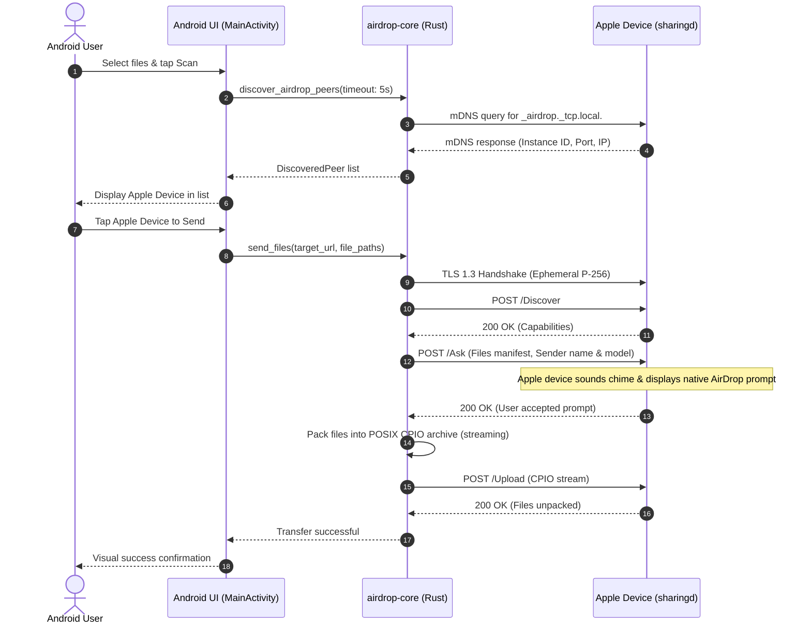
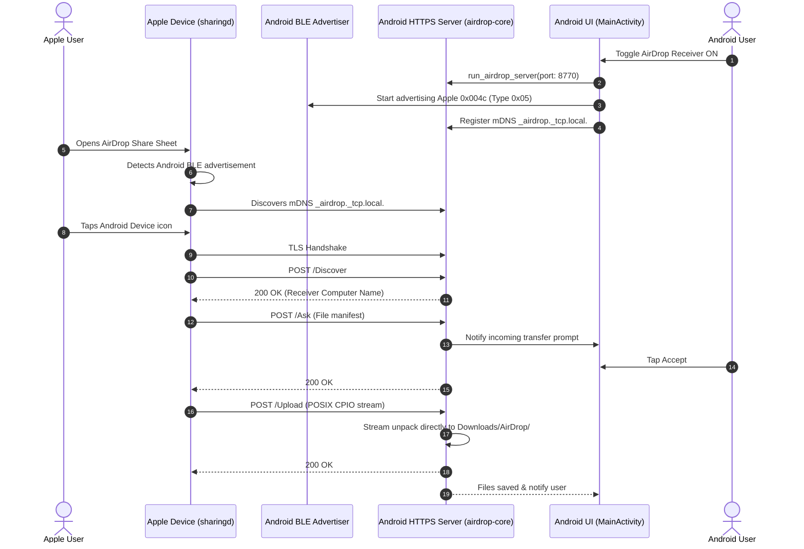

# Universal AirDrop Architecture & Data Flow

This document outlines the system architecture, internal components, communication interfaces, and cross-platform data flow for Universal AirDrop (Android ↔ Apple).

---

## 1. High-Level Component Diagram

```
+---------------------------------------------------------------------------------+
|                                 Android Client                                  |
|                                                                                 |
|  +-------------------------+     +---------------------+     +---------------+  |
|  |       MainActivity      |     |  AirDropBleManager  |     | AirDropNsdMgr |  |
|  |  (Jetpack Compose UI)   |     |   (BLE Advertiser)  |     | (mDNS Bonjour)|  |
|  +------------+------------+     +----------+----------+     +-------+-------+  |
|               |                             |                        |          |
|               v                             v                        v          |
|  +---------------------------------------------------------------------------+  |
|  |                           AirDropBridge (Kotlin)                          |  |
|  +--------------------------------------+------------------------------------+  |
|                                         | JNI (C-ABI)                           |
+-----------------------------------------|---------------------------------------+
                                          v
+---------------------------------------------------------------------------------+
|                       airdrop-jni (Rust cdylib layer)                           |
|       Java_com_airdrop_android_AirDropBridge_{init, sendFiles, startReceiver}   |
+-----------------------------------------+---------------------------------------+
                                          |
                                          v
+---------------------------------------------------------------------------------+
|                              airdrop-core (Rust)                                |
|                                                                                 |
|   +-------------------+    +-------------------+    +----------------------+    |
|   |    ble.rs         |    |   contacts.rs     |    |      tls.rs          |    |
|   | (Apple 0x004c)    |    | (SHA-256 Hashes)  |    | (P-256 ECDSA X.509)  |    |
|   +-------------------+    +-------------------+    +----------------------+    |
|   |    mdns.rs        |    |   client.rs       |    |      server.rs       |    |
|   | (_airdrop._tcp.)  |    | (/Ask, /Upload)   |    | (HTTPS Daemon)       |    |
|   +-------------------+    +-------------------+    +----------------------+    |
|   |    cpio.rs        |    |   protocol.rs     |                            |    |
|   | (POSIX Archive)   |    | (JSON / Schemas)  |                            |    |
|   +-------------------+    +-------------------+                            |    |
+---------------------------------------------------------------------------------+
                                          |
                                          | Wi-Fi LAN / Hotspot / AWDL
                                          v
+---------------------------------------------------------------------------------+
|                              Apple Device (Target)                              |
|                                                                                 |
|   +-------------------------------------------------------------------------+   |
|   |                    /usr/libexec/sharingd (macOS / iOS)                  |   |
|   |                                                                         |   |
|   |   - BLE Discovery (Apple Type 0x05 / 0x10)                              |   |
|   |   - Bonjour Service Registration (_airdrop._tcp.)                       |   |
|   |   - Ephemeral TLS Session (Port 8770)                                   |   |
|   |   - REST API Endpoints (/Discover, /Ask, /Upload)                       |   |
|   |   - Native AirDrop Prompt & UI                                          |   |
|   +-------------------------------------------------------------------------+   |
+---------------------------------------------------------------------------------+
```

---

## 2. Sequence Diagram: Android Sending to Apple Device



---

## 3. Sequence Diagram: Apple Device Sending to Android


